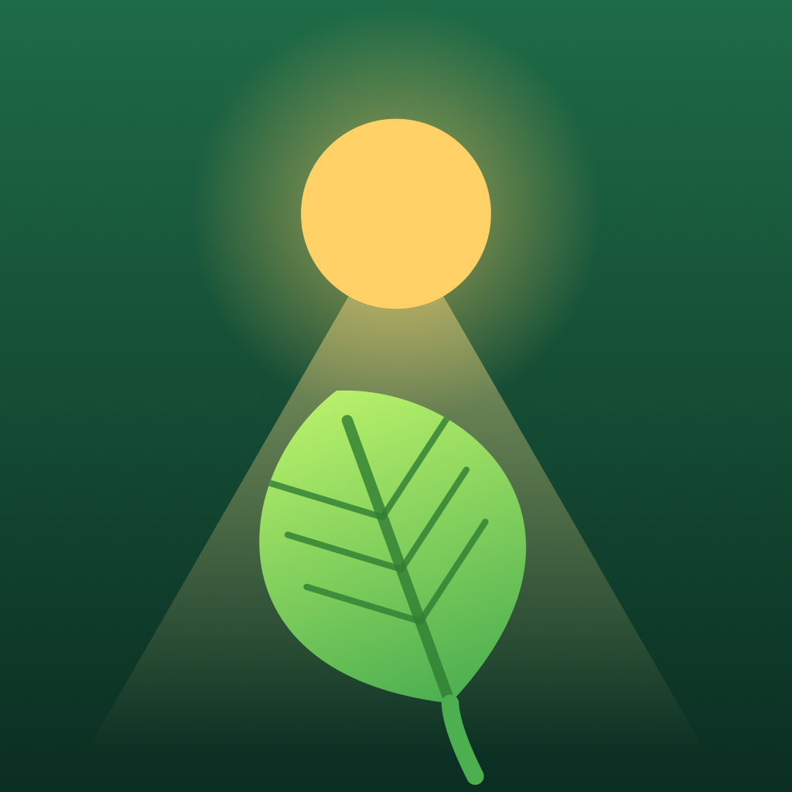

# Canopy



An iPhone light meter for growing plants. Canopy uses the camera as a light sensor and shows:

- **Lux**: how bright the light is
- **PPFD**: how much light plants can use right now (µmol/m²/s)
- **DLI**: how much light they get over a day (mol/m²/day)

It also has a light map for checking spots under a lamp, a reading log with CSV export, and a few
grow-light calculators.

## Status

Built and tested, but **not calibrated yet**. Until it's calibrated against a reference meter on the
target phone, the app says "Not calibrated" instead of showing a number. The current build collects
the calibration captures: see **Settings → Instructions** in the app.

## Build

Needs macOS with Xcode 26, plus `brew install xcodegen swiftlint`.

```sh
cp Config/Local.xcconfig.example Config/Local.xcconfig   # your Apple team ID and bundle ID
make check        # format, lint, build, unit tests
make device       # install on a connected iPhone
make testflight   # upload a build to TestFlight
```

The full plan is in [`docs/spec.md`](docs/spec.md).

## License

[MIT](LICENSE)
