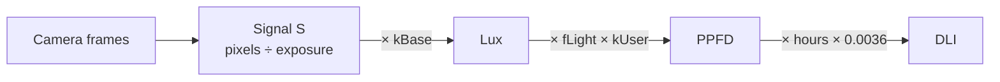

# Canopy

A camera-based light meter for growing plants, written in Swift for iPhone.

Canopy turns the phone camera into a light sensor and reports the three numbers growers
care about:

| Reading | Unit | What it tells you |
|---|---|---|
| **Lux** | lx | How bright the light looks to people |
| **PPFD** | µmol/m²/s | How much light plants can actually use, right now |
| **DLI** | mol/m²/day | How much usable light plants get over a whole day |

It started as a replacement for a paid light-meter app, built for one person's indoor grow
lights. It is calibrated against a reference meter, not guessed: until real calibration data
exists, the app says **"not calibrated"** instead of showing a number.

## How it works



1. **Signal.** Each frame is averaged over the whole image (minus a border) and normalised
   by exposure time and ISO. White balance, HDR, stabilisation and low-light boost are
   switched off so the camera behaves like a plain sensor. Frames are taken at 27 fps, a rate
   that doesn't divide 100 or 120 Hz, so mains flicker averages out.
2. **Lux** = S × `kBase`, one constant per camera and diffuser, fitted against a reference meter.
3. **PPFD** = lux × `fLight` (how much usable light each lux carries for that kind of lamp)
   × `kUser` (an optional correction the user can set against their own reference).
4. **DLI** = PPFD × hours of light per day × 0.0036.

All of the maths lives in a plain Swift package with no UI or camera code, so it is tested
on a Mac in milliseconds.

## Features

- Live lux, PPFD and DLI, with states in plain words: *Live*, *Adjusting*, *Too bright*,
  *Too dark*, *Paused*
- Tilt warning, hold button, and a reading that pauses when the phone gets hot
- **Light map**: measure a grid of spots under a lamp and see a colour map with min, max,
  average and uniformity
- **Log** with labels and notes, filters, undo, and CSV export
- **Calculators**: hours of light needed, PPFD needed, lux ↔ PPFD
- Per-setup calibration against your own reference meter

## Status

The app, the measurement pipeline and the test suite are built. Calibration is not done yet:
it needs a measuring session against a reference meter on the target phone. Until then the
app shows "not calibrated", and the light-type list is empty.

The full plan, with acceptance criteria and tests for every feature, is in
[`docs/spec.md`](docs/spec.md).

## Getting started

Requirements: macOS with Xcode 26, [XcodeGen](https://github.com/yonaskolb/XcodeGen) and
[SwiftLint](https://github.com/realm/SwiftLint) (`brew install xcodegen swiftlint`).

```sh
git clone https://github.com/waleedrizwan/canopy.git
cd canopy
cp Config/Local.xcconfig.example Config/Local.xcconfig   # add your Apple team ID and a bundle ID
make check                                               # format, lint, build, unit tests
```

| Command | What it does |
|---|---|
| `make check` | Format check, lint, build, unit tests. Must pass before shipping a build. |
| `make e2e` | End-to-end UI tests on the iPhone 17 simulator, using a simulated camera |
| `make device` | Build, install and launch on a connected iPhone |
| `make hooks` | Install a pre-commit hook that runs format and lint |

To try the app without a phone, run it in the simulator with the launch arguments
`-fixtureSignal 200 -testCalibration`. That swaps in a simulated light and clearly fake
calibration numbers.

## Project layout

```
Core/                     Swift package: all measurement maths, no UI or camera code
  Sources/CanopyCore/
    Provisional.swift     every provisional threshold in one place
    Resources/
      calibration.json    fitted constants (empty until calibrated)
  Sources/canopy-tool/    CLI: summarise captures, fit kBase against reference readings
App/Sources/              the iOS app (SwiftUI)
  Capture/                camera and simulated-camera sources
  Model/                  app state, measuring logic
  Views/                  Measure, Map, Log, Tools, Settings
App/UITests/              end-to-end smoke tests
docs/spec.md              tasks, acceptance criteria and tests
```

## Calibrating

Calibration pairs captures from Canopy with readings from a reference meter at the same spot:

```sh
make pull-spike                                           # copy captures off the phone
cd Core && swift run canopy-tool summary ../spike-data
cd Core && swift run canopy-tool fit ../spike-data lockedExposure
```

`fit` reads `spike-data/references.json` (the reference readings), fits `kBase`, and reports
whether the result meets the agreement target: median error ≤ 5%, no single reading over 10%.

## License

[MIT](LICENSE)
